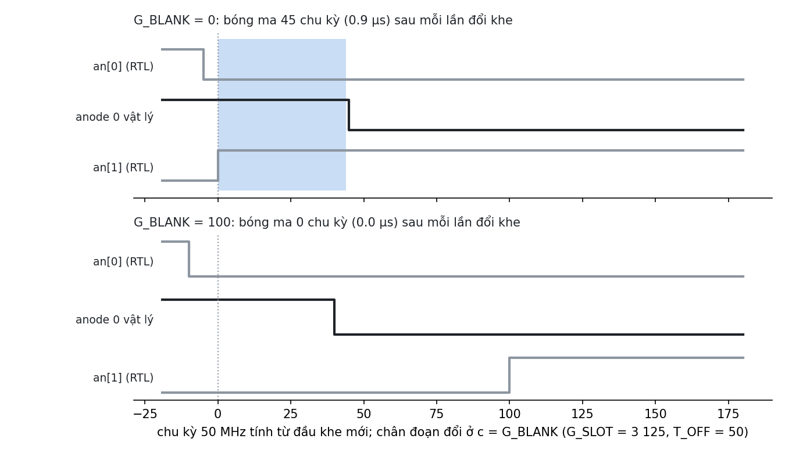

# 2.3 (phần thí nghiệm) E4′: bóng ma LED 7 đoạn

> Bản nháp 26/10, sửa 27/10 (Claude viết; chủ: TV4 chạy lại và viết bằng lời mình). Số liệu: `evidence/20261026_exp_e4.log` (RTL cũ), `evidence/20261027_exp_e4_fix.log` (sau khi sửa).
> Công cụ: `tb/exp_e4_tb.v` (trong hồi quy; `+slow` chạy đủ 2 khung ở `G_SLOT = 50 000`), `tools/exp_e4.py` (vẽ hình).
> Ảnh VGA 1 khung (yêu cầu thứ 2 của E4′) đã có từ trước: `work/vga_frame.ppm` / `.png` (`tb/vga_digits_tb.v`).

## Bóng ma từ đâu ra

- Các chữ số dùng chung 7 chân đoạn và được quét lần lượt. Trong RTL, anode và chân đoạn đổi ở **cùng một cạnh clock** → mô phỏng thuần không bao giờ thấy bóng ma.
- Trên mạch thật, anode được kéo bằng transistor, mà transistor **tắt chậm** (thời gian xả, cỡ µs). Anode cũ vẫn còn dẫn thêm `T_OFF` sau khi tín hiệu về 0, đúng lúc chân đoạn đã mang mẫu của chữ số kế → chữ số cũ sáng mờ mẫu của chữ số mới.
- tb mô hình hóa điều đó: anode "vật lý" = tín hiệu RTL kéo dài thêm `T_OFF` chu kỳ. `T_OFF` = 50 chu kỳ (1 µs) và 150 (3 µs) là **giả định**, không đo từ board.
- Đo: tỉ lệ (số chu kỳ có đoạn sáng sai) / (số chu kỳ anode dẫn) ≈ độ sáng bóng ma so với đoạn thật.

## Kết quả (RTL cũ, 26/10: chân đoạn đổi ở `c = 0`)

| `G_SLOT` (tần số mỗi chữ số) | `G_BLANK` | `T_OFF` | Bóng ma mỗi lần đổi khe | Tỉ lệ |
|---|---|---|---|---|
| 50 000 (125 Hz) | 0 | 1 µs | 45 chu kỳ | 0,07 % |
| 50 000 (125 Hz) | 100 | 1 µs | 40 chu kỳ | 0,06 % |
| 12 500 (500 Hz) | 0 | 1 µs | 45 chu kỳ | 0,31 % |
| 12 500 (500 Hz) | 100 | 1 µs | 40 chu kỳ | 0,28 % |
| 3 125 (2 kHz) | 0 | 1 µs | 45 chu kỳ | 1,24 % |
| 3 125 (2 kHz) | 100 | 1 µs | 40 chu kỳ | 1,14 % |
| 3 125 (2 kHz) | 0 | 3 µs | 145 chu kỳ | 3,88 % |
| 3 125 (2 kHz) | 100 | 3 µs | 140 chu kỳ | 3,87 % |

Mọi con số khớp đúng công thức: **bóng ma mỗi lần đổi khe = `T_OFF − gap`**, với `gap = G_SLOT − G_BLANK − 15 · G_STEP` là phần dư của PWM ở cuối khe (5–10 chu kỳ). 7 trên 8 lần đổi khe có bóng ma; lần đổi 8 → 1 thì không, vì chữ số 8 đã sáng đủ 7 đoạn.

## Phát hiện: `G_BLANK` (RTL cũ) không chống được kiểu bóng ma này

- Khoảng tắt `G_BLANK` nằm ở **đầu khe mới**, còn chân đoạn đổi ngay ở `c = 0`. Vì vậy khoảng tắt chỉ làm anode **mới** bật muộn đi; anode **cũ** đang tắt dần vẫn gặp mẫu đoạn mới (hình trên).
- Kiểu bóng ma mà `G_BLANK` hiện tại chặn được là chiều ngược lại: chân đoạn đổi chậm trong khi anode mới đã bật. Nhưng chân đoạn nối thẳng FPGA thì đổi nhanh (ns), còn anode qua transistor mới chậm (`inference`, chưa có board để đo).
- **Cách sửa (đã làm 27/10, Long chọn):** cho chân đoạn đổi ở `c = G_BLANK` thay vì `c = 0`. Khi đó trong khoảng tắt, chân đoạn vẫn giữ mẫu của chữ số cũ, nên phần đuôi của anode cũ hiện đúng chữ số của nó. Theo công thức, bóng ma còn `T_OFF − gap − G_BLANK`, tức về 0 khi `G_BLANK ≥ T_OFF`. Đã sửa `src/seg7_scan.v` (dòng `js = c < G_BLANK ? j − 1 : j`), display-spec §4 và D-2, `seg7_tb` (25 362 PASS). Sau khi sửa: `G_BLANK = 100`, `T_OFF = 1 µs` → bóng ma **0** ở cả 3 `G_SLOT`; `T_OFF = 3 µs` → 40 chu kỳ/lần = 150 − 10 − 100 (1,1 %), khớp công thức (`verified` trong mô hình). `G_BLANK = 0` không đổi (45 / 145 chu kỳ). Hình trên vẽ sau khi sửa: khung dưới không còn vùng tô.
- Khe ngắn hơn (quét nhanh hơn) thì tỉ lệ bóng ma tăng tỉ lệ thuận, vì phần đuôi cố định còn thời gian sáng giảm. Ở 125 Hz (mặc định) chỉ 0,07 %, gần như không nhìn thấy.

## Hạn chế

- `T_OFF` là giả định. Nếu có board, đo thật bằng cách chụp ảnh chữ số ở `G_SLOT` nhỏ. Nếu `T_OFF` thật > 2 µs thì cần tăng `G_BLANK`.
- Chưa mô hình chiều ngược (chân đoạn đổi chậm so với anode). Sau khi sửa, đoạn và anode mới đổi cùng cạnh `c = G_BLANK`, nên nếu chân đoạn có trễ đáng kể thì anode mới sẽ hiện đuôi mẫu cũ trong khoảng trễ đó (`inference`, cỡ ns với chân FPGA nối thẳng).
- Độ sáng chọn tối đa (`BRIGHT = 15`). Độ sáng thấp hơn để lại một khoảng PWM tắt lớn ở cuối khe (≥ `G_STEP`), nên tự hết bóng ma.
